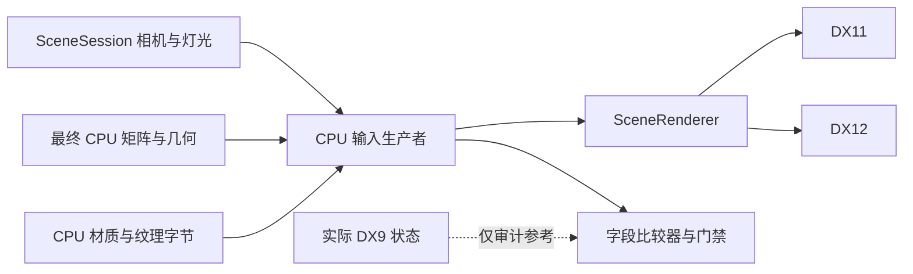

# CPU 模型着色输入与材质 13 诊断

本阶段建立 CPU 输入生产者，并为真实 PMM 材质 13 增加默认关闭的字段审计。
应用仍用 DX9 绘制。真实 PMM 的新一轮审计尚未通过，直接输入诊断保持门禁。

## 数据与所有权

`render_model_inputs.hpp` 定义三个输入：

| 输入 | 来源及职责 |
| --- | --- |
| `ModelFrameInputs` | `SceneSession` 的帧、相机与灯光；旧 CPU 运行时的最终世界／灯光旋转矩阵 |
| `ModelViewSettings` | 显式编辑导航、视口、宽高比、投影范围和 FOV 换算政策 |
| `ModelMaterialInputs` / `ModelPassSettings` | CPU 材质工作记录、纹理引用、模型通道及过滤政策 |

相机模式使用会话相机；模型编辑模式显式提供导航眼点、FOV 和投影方式。
MMD 的目标平移／相机旋转保存在最终世界矩阵，视图使用固定 +Z 朝向。
骨骼矩阵、IK、物理和蒙皮仍沿用已有 CPU 求解时序。

`BuildModelInputs` 生成完整 `ModelPipeline`：矩阵、法线矩阵、方向灯、材质颜色、
Toon/Sphere 坐标、三阶段采样、混合、深度、模板和视口。没有图形设备参数。
`ModelInputMath` 是 CPU 数学运算政策；默认实现可移植，Windows 诊断使用已有
D3DX 的矩阵、归一化和三角函数运算。数学政策与 GPU 后端选择分开。
饰品灯光阶段的环境色减／加 0.3 运算单独表达，保留可观察到的舍入。

纹理从模型 CPU 引用、共享 Toon 文件或内嵌原始字节解码。
CPU 纹理保存在 `ModelCpuFrame::materials`，随模型卸载释放；RHI 的上传缓存、
版本、fence 回收和设备替换仍由共用 `SceneRenderer` 管理。



## 字段审计和直接输入

`SubmitLiveCpuModelInputs` 在固定功能模型绘制边界构建 CPU 输入。
`AuditLiveCpuModelInputs` 是独立诊断参考读取器；审计模式才读取 DX9 状态／纹理。
`CompareModelInputs` 比较语义字段，输出字段名、分量、两侧值及差值。
未启用的纹理阶段和灯光不影响该绘制，比较器排除它们的残留状态。
审计还检查网格范围、活动纹理 RGBA、视口及原生着色器是否符合固定功能范围。

字段通过后，DX11／DX12 同时绘制 CPU 输入和原生状态参考输入，使用同一 CPU
几何、CPU 纹理和单采样离屏目标。比较两个后端及参考／生成路径的图像。
这是独立批次验收；不包含实际应用的遮挡历史或整帧 DX9 图像等价声明。

```powershell
python tools/run_cpu_geometry_diagnostic.py `
  --gui build-x64/build/Release/pmm_v1_relocation_gui_test.exe `
  --application build-x64/build/Release/MikuDanceStudio.exe `
  --fixture C:/Users/jstzw/Downloads/MikuMikuDanceE_v932/UserFile/sample.pmm `
  --output exports/cpu-inputs-audit-new-x64 --preview --material 13 --play --inputs audit
```

换成 x86 可执行文件重复验收。`cpu_inputs.csv` 记录每次绘制的结果和差异，
`cpu_preview.csv` 记录图像、覆盖像素和缓存上传次数；GUI 仍执行编辑、Save As、
回读和重新打开。证据目录必须新建，素材和图像保存在忽略的 `exports/`。

只有该运行的 `run.json` 为 PASS，才能使用 `--inputs direct --accepted-audit <目录>`。
脚本核对程序、PMM 的 SHA-256，以及模型重选参数、材质和契约版本。
直接模式不调用原生状态参考读取器，也绕过旧批次桥的 GPU 网格读取／纹理借用。
CPU 几何使用最终 CPU 世界矩阵，并在已验收的 producer 发布后就绪；不再依赖
原生缓冲比较结果。`cpu_geometry.csv` 用 `cpu_source` 标记它，不能将其计作零差异
独立字节对照。旧 DX9 应用为自身绘制进行的缓冲写入仍继续运行。
它仍是嵌在 DX9 应用中的离屏诊断，尚未提供独立的应用后端切换。

底层开关为 `MDS_RHI_CPU_INPUTS`、`MDS_RHI_CPU_INPUTS_AUDIT`，默认关闭。
直接诊断还要求显式 `MDS_RHI_CPU_INPUTS_ACCEPTED`；建议使用上述验收脚本提供门禁。
存在依赖、MME、立体绘制、PMX、显示／额外通道覆盖、缺失 CPU 纹理、未验收的
Mip 或不支持的过滤政策时，当前入口阻断并保留原 DX9 绘制。

## 灯光编辑与播放

`SceneSession::ReplaceRuntimeLightTrack` 与模型、相机同步遵循同一约束：
更新并验证链接后原始字节包失效，不能直接保存旧包；Windows 保存适配器先重新
序列化并回读。可移植 `Edit → Seek → Save → 回读` 仍使用文档编辑接口。

Windows 桥在跳帧及开始播放前同步已注册的灯光关键帧。
会话跳帧使用双精度插值比例，播放沿用浮点比例，以对应既有两种运算路径。
未注册的临时灯光编辑和旧运行时的播放门控仍须在实际字段审计中确认。
审计差异不会被增大容差或自动写回原生状态掩盖。

Windows 的相机和灯光门控不一定随模型一起推进。`SceneSession` 现在区分求值的
`Pose` 与宿主实际应用的 `RuntimeAppliedCamera` / `RuntimeAppliedLight`；桥在应用状态时
发布 CPU 值，着色输入消费这份显示状态。独立宿主不设置它们，继续使用 `Pose`。
这两个可选状态不会改写关键帧，也不会阻止会话求值；非有限输入被拒绝且保留之前的有效状态。

## 2026-10-05 验证

| 验证 | 结果 |
| --- | --- |
| Windows 无界面资源测试 | 10/10；新增 CPU 相机／灯光、Toon/Sphere、差异定位与拥有资源的提交输入测试 |
| 用户 Linux 主机资源测试 | 10/10；使用同一无界面测试入口 |
| x64 / x86 定向测试 | 各 8/8：输入、灯光文档／求值／编辑桥、DX11/DX12 硬件及 WARP 生命周期 |
| x64 / x86 CPU 几何门禁测试 | 各 1/1：原独立对照与新直接模式；无原生缓冲字节也能发布已验收 producer 的结果 |
| 生成输入的原生生命周期 | 每个后端／驱动覆盖 1000 次几何版本、8 次目标调整、缓存复用、拒绝旧提交及设备替换图像一致性 |
| Linux 灯光文档与求值 | 2/2；覆盖运行时同步失效包拒绝、可移植编辑保存回读及分数帧求值 |
| macOS | 三平台 CI 的资源入口已包含新增测试；本轮没有新的 macOS 实测 |
| 真实 PMM 新字段及图像审计 | 未完成：应用创建设备失败，DX9 探针全部返回 `0x8876086C`，RDP 会话为 Disc |

日志位于 `exports/cpu-inputs-check-x64.log`、`exports/cpu-inputs-check-x86.log`、
`exports/cpu-inputs-gpu-final-x64.log`、`exports/cpu-inputs-gpu-final-x86.log`、
`exports/cpu-inputs-linux-final.log`、`exports/cpu-inputs-linux-formats.log`、
`exports/cpu-inputs-dx9-probe.log`。首次真实运行失败保存在
`exports/cpu-inputs-audit-initial-x64`。

下一步恢复可创建设备的 DX9 环境，按两个架构完成材质 13 字段和多帧图像审计，
再验证直接模式。通过之前保持 PMX、多材质、描边、地面、饰品和阴影扩展关闭。

## 2026-10-06 RDP 恢复后的验收

DX9 x64/x86 探针均能实际创建设备，HRESULT 为零。真实 v1 `sample.pmm` 的模型槽位 2、
材质 13 在 NVIDIA TITAN Xp 上完成跳帧、编辑、播放、Save As、回读和重新打开。
所有最终运行还启用了 `--lifecycle`，验证两个后端的离屏目标扩大并恢复、拒绝旧提交、
替换设备、用保留的 CPU 数据重新上传、恢复后图像一致。单采样；应用仍使用 DX9。

| 最终运行 | 字段审计 | 独立批次图像 | 生命周期 |
| --- | --- | --- | --- |
| x64 audit | 118 次，零字段／纹理差异 | 118 次，零像素差异 | DX11/DX12 各 resize、replace，4/4 |
| x86 audit | 208 次，零字段／纹理差异 | 208 次，零像素差异 | 4/4 |
| x64 direct | 关闭原生状态参考读取 | 197 次，DX11/DX12 零差异 | 4/4 |
| x86 direct | 关闭原生状态参考读取 | 231 次，DX11/DX12 零差异 | 4/4 |

audit 的几何独立字节对照分别为 118、208 次，零差异。direct 的几何记录分别为
197、231 次 `cpu_source`，独立字节对照次数为零，不能冒充原生字节对照。
两种模式的 GUI 运行每次有 7116 项运行时检查，相机链在保存前和写入时有效。
图像含义仍是本文件上述 CPU 生成输入、DX9 状态参考输入与两个离屏后端的比较，
没有新增整帧 DX9 图像等价声明。

本轮修正三个暴露的问题：

- Toon 叉积在 x86 使用旧路径的 x87 舍入。`legacy_model_cpu_math.hpp` 由旧绘制与
  新生产者共用；`ModelInputMath::cross` 表达 CPU 运算策略，可移植默认实现仍独立。
- DX9 状态缓存失效不再销毁独立 DX11/DX12 预览设备与 CPU 资源缓存；加载新场景和
  应用退出负责释放它们。目标缩放保留纹理，设备替换后才重新上传。
- 全局关键帧注册先检查第 0 条记录。以前存在后续键时，注册第 0 帧会分配一个
  `frame == 0` 的稀疏槽并将其接到头部，破坏相机链。新增真实命令连续注册两次的回归检查。

早期失败证据保留在 `exports/cpu-inputs-recovery-audit-x64`（相机链失效）和
`exports/cpu-inputs-recovery-audit-x86`（Toon 1 ULP 差异及缓存被反复清空），未计入通过结果。
最终证据为 `exports/cpu-inputs-final-{audit,direct}-{x64,x86}/run.json` 及同目录 CSV、GUI 日志。
direct 脚本要求对应 audit 通过且应用／素材 SHA-256 和契约版本一致；不会沿用旧构建的准入结果。

Windows 重新构建后的无界面资源测试 10/10；两个架构的输入、场景文档和求值测试各 3/3。
DX11/DX12 WARP 常驻场景测试在两个架构各 2/2，包含 1000 次版本更新、8 次目标调整和设备替换。
用户 Linux 主机上的资源测试 10/10、场景文档及求值测试 2/2。
`pmm_scene_timeline_bridge` CTest 因未提供单模型外部素材返回 77，未计作通过；
本轮真实 Windows 桥验收由上述 GUI 工作流完成。没有新增 macOS 实测结果。

当前完成标准达成于这个选定实时批次：几何、纹理和着色输入无需读取 DX9 GPU 对象或状态。
后续有序多材质提交和契约版本 3 的新门禁见 [RHI_CPU_MULTIMATERIAL.md](RHI_CPU_MULTIMATERIAL.md)；
上述单材质验收属于其记录的构建，不能直接批准后续新构建。
后续先扩展同一 CPU 契约到多材质及绘制顺序，再逐项迁移描边、地面、饰品和阴影；
完整应用呈现、MME 与 8× MSAA 仍需独立验收。
