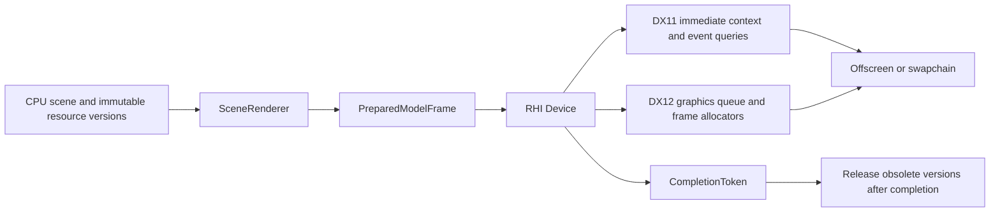

# Resident scene submission and DX12

Implementation and local evidence: 2026-10-05. This is the single-sample
resource/submission milestone, not activation of a replacement application renderer.

The 2026-10-13 [CPU frame and resident preview acceptance](RHI_CPU_FRAME_PREVIEW.md)
adds default-off DX11/DX12 application windows. Real PMM v1/v2 seek, playback,
editing, save/reopen, window recovery and device replacement passed on x86/x64;
the primary application window remains DX9.

## Ownership

The design borrows Unity's separation of scene resources, common drawing inputs,
native devices and completion-controlled resource retirement. It does not copy
Unity's class hierarchy or implementation.



`SceneRenderer` owns CPU snapshots and GPU handles, scoped by a nonzero scene
namespace. A resource key is `(id, version)`, and the bytes of a live version
cannot change. A new `Prepare` supersedes previously prepared commands for that
scene. Intentional repeated `Submit` of the same prepared frame is supported.
Retired version numbers cannot be revived while the scene namespace remains loaded.
Different scene namespaces never share handles merely because their IDs match.
`ModelFeatures` publishes implemented layouts, draw forms, mip policies,
outputs and frame draw limits. Preparation rejects unsupported contracts before
uploading or changing the target. Native device calls still validate complete
pipelines and ranges rather than relying solely on capability flags.

`Prepare` validates the complete stream, uploads missing versions and selects an
output. `Submit` uses the prepared handles; it does not rebuild targets, upload
scene resources or read images. Native devices still validate draw arguments.
Image readback is a separate diagnostic operation.

`FrameOutput::Offscreen` selects an RGBA8/D24S8 target. `Presentation` selects the
current swapchain attachments, whose dimensions and formats must already match.
Resizing belongs to `Swapchain::Rebuild`; the renderer cannot silently change the
window's surface parameters. Present is a separate device call after submission.

The device identity and epoch reject stale commands. A `CompletionToken` is
instead a device identity plus a monotonic queue point; resizing does not make
an already issued completion token meaningless. Epoch is not a GPU fence.
Missing completion signals stop further scene submission and resource retirement.
Confirmed native `DeviceState::Removed` terminates old-device execution and
allows CPU recovery. Reset-pending state or a fence timeout cannot substitute
for that evidence. The DX12 isolated removal test calls `ID3D12Device5::RemoveDevice`
on the test backend, not a driver-wide TDR.
The test runs in its own process: D3D12 can share the native device between
backend instances on one adapter. Recreating that adapter's removed device
requires releasing every old native reference first. `Detach` releases GPU
ownership while preserving CPU versions, followed by device destruction,
creation, `Rebind` and resource preparation. Failed fence waits do not detach.
`Rebind` waits for tracked work, frees old GPU handles and keeps CPU versions for
reupload. The old device must remain alive until cache owners release or rebind.

## DX11 and DX12 implementation

Both devices use the same model HLSL sources and CPU constant transport.
`ModelOptions` chooses default arithmetic or the optional measured DX9 policy;
the latter explicitly requires shader doubles. The existing DX11-specific option
names are source aliases. A measured policy is not a promise of parity on untested GPUs.

DX11 caches samplers, blend/depth/raster states and model constant buffers.
Event queries track completion, with at most three resident submissions in flight.

DX12 owns one direct queue, a native fence and three frame contexts. Each frame
owns its command allocator/list, shader-visible SRV and sampler heaps, mapped
constant storage and upload references. Reuse waits for that frame's fence.
Default-heap geometry and textures receive queued uploads; the backend records
copy-to-vertex/index/SRV barriers. The scene producer has no native barrier API.
PSOs are cached by immutable raster/depth/blend state and vertex layout; matrices,
textures, viewport and stencil reference do not cause new PSOs.

The current limits are 512 draws per native frame, 8,192 live resource slots and
one single-sample output. Explicit mip chains and sRGB views are supported;
DX12 rejects backend-generated mip chains. Model layouts are PositionNormalUv
and PositionColor, with indexed/nonindexed triangles or lines. The HUD subset
uses ScreenPositionColorUv triangles, the shared `fixed_screen.hlsl`, point/linear
sampling, modulated color, optional blending and Always/LessEqual depth. Other
fixed-function requests return failure rather than silently losing states.

Swapchain support is Win32, windowed RGBA8, single sample, discard semantics
(DX12 implements flip discard), Immediate/VSync and None/D16/D24S8 depth.
Scene submission requires D24S8. MSAA, arbitrary target changes and MME are not
implemented by this scene path.

Two lifecycle issues were found during debug-layer testing and corrected:

- Debug configuration occurs once before the first DX12 device. Enabling the
  layer during replacement can remove devices that already exist; a late
  request to enable it is explicitly rejected.
- Present can enqueue work after the frame fence. Rebuild establishes a new
  queue completion boundary before freeing DXGI backbuffers; waiting only for
  the render fence caused debug-layer resource-lifetime errors.

## Verification

Native removal recovery verifies the detach-before-recreation requirement above.
It creates a fresh native device after old references are released; a new wrapper
identity alone does not prove that the native device has been replaced.

`rhi_scene_renderer_test` uses deliberately delayed completion to verify version
immutability, scene separation, failed uploads/signals, stale frames, rebinding
and bounded retirement during 1,000 geometry versions. It requires no native API.
The standalone resource suite and the existing three-OS resource CI include it.

`rhi_backend_scene_test` runs the same contracts on DX11/DX12 Hardware and WARP:
resize, minimize/restore, presentation, model/HUD transitions, 1,000 retained
frames, texture edits, 1,000 geometry versions, offscreen resize and replacement.
DX12 debug-layer tests are separate CTest entries. Backend unavailability is
recorded as a skip, not a passing image gate.

The private `--resident-pmm` fixture feeds the captured real PMM stream into the
same renderer, not a separate DX12 replay engine. It compares all 51 prefixes
against DX9 captures, repeats the final prefix 1,000 times without resource
uploads, resizes six times and switches the scene between DX11 and DX12. The
initialized viewport is the image comparison region; pixels outside the captured
region are not evidence. Captures contain external model/texture data and remain
under ignored `exports/`.

Commands:

Local results (NVIDIA TITAN Xp / WARP, x64 and x86):

| Verification | Result |
| --- | --- |
| Focused scene/backend/lifecycle/viewport/material CTests | 15/15 per architecture; none skipped |
| Real captured stream: x64, x86 sharing x64 data, original x86 data | 348 exact image checks total; DX11 and DX12 |
| Retained final scene | 1,000 submissions per backend per capture run; 143 uploads / 42 textures before backend switch |
| Backend switch using retained CPU versions | Both directions exact; 286 cumulative uploads after switch |
| Geometry-version retirement | 1,000 changes, bounded pending retirement; textures retained |
| Native DX12 removal/recreation | Hardware/WARP, debug layer, CPU scene restored |
| Windows standalone portable resource suite | 8/8 |
| Linux remote standalone resource suite | 8/8 on the user-provided host |
| Existing Windows application build | Release x64 and x86 linked successfully |
| DX12 enabled while DX9/DX11 adapters disabled | Built and portable scene test passed |
| macOS | CI includes new tests; no new macOS run verified locally |

Private evidence roots: `exports/resident-pmm-verified-x64`,
`exports/resident-pmm-verified-x86-shared`, `exports/resident-pmm-verified-x86-native`.
Their CSV rows compare only the captured initialized viewport. Test logs and
Linux results are `exports/resident-verified-tests-*.log` and
`exports/resident-linux-final.log`.

```powershell
ctest --test-dir build-x64/build -C Release -R 'rhi_resident_|rhi_scene_renderer' --output-on-failure
build-x64/build/Release/rhi_d3d9_replay_conversion_test.exe --resident-pmm exports/ground-rhi-prefix-x64 exports/resident-pmm-result
```

```sh
cmake -S cmake/rhi-resource-tests -B build-resources -DCMAKE_BUILD_TYPE=Release
cmake --build build-resources --parallel 2
ctest --test-dir build-resources --output-on-failure
```

The application still renders through DX9. Live CPU model geometry is now
available through an opt-in bridge; see [the CPU geometry milestone](RHI_CPU_GEOMETRY.md).
Remaining production work includes material/state inputs independent of DX9, complete pass/HUD and
self-shadow coverage. MME, full-frame MSAA and multiple-GPU parity remain separate
acceptance requirements; see [the integration roadmap](RHI_DX11_DX12_ROADMAP.md).
